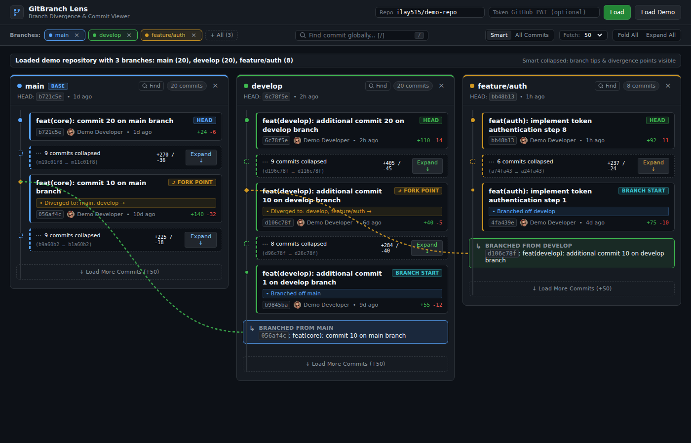

# GitBranch Lens

A client-only single-page web app for inspecting Git branches with **multi-column swimlanes** and **smart commit collapsing**.



Standard Git viewers bury branch relationships under hundreds of linear commits. GitBranch Lens separates each branch into its own dedicated column, keeping linear intermediate commits collapsed so you can immediately see the **branch tips (HEADs)**, **common ancestors (fork points)**, and **where branches diverged**.

---

## Features

- **Clean Developer UI**: Disciplined, distraction-free interface built with dark developer tokens, clear visual hierarchy, and zero gimmicky neon glows.
- **Smart vs All Commits View Modes**: Toggle between **Smart** mode (intermediate linear commits collapsed into compact capsules) and **All Commits** mode (every single commit shown along the branch timeline).
- **Configurable Commit Depth & "Load More Commits"**: Select initial fetch depth (30, 50, 100, 200 commits per branch) or click `↓ Load More Commits (+50)` at the bottom of any branch column to continuously load deeper commit history.
- **Find Globally Tool (`/`)**: Search across all active branches by commit message, author name, or SHA hash. Features auto-expansion of collapsed chains containing matches, match counter, and prev/next navigation (`Enter` / `Shift+Enter`).
- **Find Commit on Branch**: Inline search tool directly inside each branch column header. Quickly filter or highlight commits within a specific branch.
- **Multi-Column Swimlane Layout**: Each branch has its own dedicated column. Commit messages and cards are cleanly separated and never cramped together.
- **Direct Branch Disable / Enable**: Toggle any branch on or off directly from the column header (`×`) or the main toolbar pills.
- **Smart Commit Collapsing**: Intermediate linear commits are collapsed into compact capsules (`... 18 commits collapsed ...`). Expand or fold them with a single click.
- **Visual Divergence & Cross-Column Connectors**:
  - Highlights common ancestors and fork points where branches branched off.
  - Smooth Bézier SVG arcs bridge between columns to show divergence paths.
  - Origin banners (e.g. `↳ Branched from develop @ a81491e`) link directly to the parent commit.
- **Commit Inspector Drawer**: Click any commit to view full details, diff statistics, author info, SHA copy tool, and direct GitHub links.
- **Interactive Offline Demo Mode**: Explore sample multi-branch repositories (`main`, `develop`, `feature/auth`) without requiring a token or network connection.
- **GitHub REST API Integration**: Enter any public repository (`owner/repo`) or add a Personal Access Token (PAT) for private repos and higher rate limits.

---

## Quick Start

### Direct Browser Usage (Zero Dependencies)
Simply open `index.html` in any browser:
```bash
# Linux
xdg-open index.html

# macOS
open index.html
```

### Local Static Server (Optional)
```bash
npx serve .
# or
npm run dev
```

---

## License
MIT
